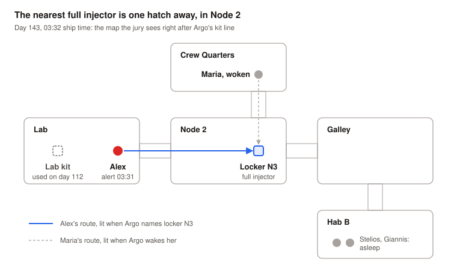

# Day 143: the sketch and the 7-minute pitch

> Exported from the shared Claude Doc ("Day 143: the sketch and the 7-minute pitch") on Nov 6, 2026. If the two ever differ, ask Alex which one is current.

## Why this scenario

Use a severe allergic reaction: anyone understands it, it can kill faster than Earth can answer, and the map decides where the injector is.

- **Instantly understood.** Everyone knows allergies and epinephrine injectors, so the jury needs no science lesson before the story starts.
- **It can't wait for Earth.** The danger grows in minutes and Houston's earliest reply is 25 minutes away, so the delay becomes the plot instead of a slide.
- **The map changes what he does.** The nearest kit is empty, the next one is through a hatch, and the nearest crewmate gets woken and routed.
- **The design shows itself.** Argo speaks first, asks before concluding, follows an onboard procedure, and the astronaut makes the call.

CO2 pooling was the other candidate. It's cleverer, but it needs a physics explanation, and a headache can wait 25 minutes.

## The 7-minute run of show

Frozen by Alex on Nov 7, night (docs/05 decision 29). The sketch is one segment in the middle, opened with one line; the rest of the pitch stands on its own. The live sketch measures 1:51 from key 1 to the end of Argo's last line at the script's pace (normal test run), about 1:55 with the cue line and the step aside, so it gets 1:55 and "Our idea" gives up 10 s, since the sketch shows the idea. (Until then the plan gave the sketch 1:45, for a 1:40 video.)

| Time | Block | On the screen | Said |
| --- | --- | --- | --- |
| 0:00 to 1:00 | The problem | Slides: the title (Argonauts, Argo), then the clock: Mars is 12:40 away, Earth's earliest reply 25:20. | Team intro. "Mars is 12 minutes and 40 seconds away. Not in kilometers. In time." |
| 1:00 to 1:50 | Our idea | Slide: Argo combines your vitals with the ship (map, crew, supplies) and a voice that follows the onboard procedures. From about 1:30, the live app, calm: the Lab display at 3:31 in the morning, the crew asleep, the team's four faces on the crew tiles. | "This is Argo on board, at half past three in the morning. Everyone is asleep except Alex." Then the cue line: "Let's see how our app helps during a crisis." |
| 1:50 to 3:45 | The sketch | The live app, cue by cue (operator cue list in `design/v2-brief.md`). | Alex and Argo, in English. The presenters step aside. |
| 3:45 to 5:10 | How it works | First minute: the live app stays up, and about 50 s after Argo's last line the alarm steps down to a cyan advisory. Then the analysis slide: one chart, one claim, its false-alarm rate (decision 22). | The three layers, each tied to a moment the jury saw (see "How it works, after the sketch"). Point at the step-down as it happens. |
| 5:10 to 6:20 | Why trust it | Slide: it advises and never acts; every line shows its source; the false-alarm rate. "Prototype: scripted scenario, simulated data, pre-written lines." | Say plainly that the app is a prototype (decision 8). |
| 6:20 to 7:00 | Close | Slide: "Earth will always be 12 minutes away. Argo is already on board." Team name, and a QR code to the online demo once it is up. | The close line. |

Rehearse it to 6:40, so transitions and a slow laptop have room.

The live app is on the projector from about 1:30 to about 4:45 (the calm ship before the alarm, the sketch, and the step-down after it); slides the rest of the time. The app itself is calm until key 1, then shows each cue as in the operator cue list. Nothing in the app changes because of the freeze. How to stage it is below.

## The sketch: Day 143

Day 143 runs about 1:51 from key 1 to the end of Argo's last line: the live app plays it from the operator's keys, and Alex, playing the patient, answers it live. (Until Nov 7 this was a 1:40 prerecorded video with gaps.)

Build this layout into the app. Stelios and Giannis are two hatches away in Hab B, which is why Argo wakes Maria. (Since Nov 7, night, the crew carries the team's own names, docs/05 decision 14: Alex, Maria, Stelios and Giannis were Nikos, Sarah, Mike and Leo, and Leo was Ana before that.)

**Cast**

- **Alex**, the flight engineer who has the reaction, played live by Alex himself; the teammates who present step aside for the sketch (docs/05 decision 14).
- **Argo**, the onboard AI: the live app's voice, its lines pre-written (docs/05 decision 4). The name is confirmed (decision 23): in the myth, a beam of Dodona oak built into the Argo could speak and advise its crew.
- **Maria**, crew medical officer, seen only on screen: her crew tile and her dot on the map.

**On screen the whole time**

- The habitat map, with crew as dots and med kits as icons.
- Alex's vitals, drawn against his personal baseline band.
- Two clocks: "Earth sees this in 12:40" and "Earliest reply in 25:20".
- A "listening" indicator during every gap. It's also the actor's cue to speak.

**Script and timings**

The times are from the old video plan. The live app follows Alex instead: each ALEX line is his live answer, the operator presses Next when he has finished, and every time and number Argo says comes from the screen at that moment, so the real times shift with his pace (about 1:51 in all at this pace). The opening caption is not needed: the ship clock shows the time.

*0:00. Caption: "Day 143, 03:31 ship time." Alex is alone in the Lab; the crew is asleep.*

**0:02 ARGO:** Alex, your heart rate is up 35 percent from your normal, and your oxygen is dropping. You're not on the treadmill. How are you feeling?

*Screen: heart rate and oxygen turn amber, above his baseline band.*

**0:11 ALEX (live, 5 s):** I'm fine, just... (coughs) My throat's itchy. It feels tight.

**0:16 ARGO:** Any swelling in your lips or face?

**0:19 ALEX (live, 4 s):** (touches his lips) Yeah. My lips.

**0:23 ARGO:** Tight throat, swelling, fast heart, falling oxygen. That matches the onboard procedure for a severe allergic reaction. Step one is epinephrine.

*Screen: the procedure card opens on step 1, with the four matching signals beside it.*

**0:32 ALEX (live, 4 s):** Shouldn't we call Houston first?

**0:36 ARGO:** Houston sees this in 12 minutes. Their answer gets here in 25, at the earliest. At this rate, your oxygen drops below 90 in about four minutes. The procedure says don't wait.

*Screen: a third clock appears in red: "Oxygen below 90%: 4:10".*

**0:48 ALEX (live, 3 s):** Okay. The kit's right here. (reaches to his side)

**0:51 ARGO:** That kit's injector was used on day 112. The closest one is in Node 2, through the hatch behind you. Locker N3. I've woken Maria.

*Screen: the Lab kit greys out, the route to N3 lights up, and Maria's dot starts moving.*

**1:01 ALEX (live, 6 s):** (crosses the stage as his dot moves, mimes opening the locker) Got it.

**1:07 ARGO:** Outer thigh. Through the fabric is fine.

**1:10 ALEX (live, 4 s):** (mimes the injection) Done.

**1:14 ARGO:** Logged at 03:34. If you're not better in five minutes, the second injector is in the same locker.

*Screen: his vitals drift back toward the baseline band, the red clock disappears, and Maria's dot reaches him.*

**1:21 ALEX (live, 4 s):** (breathing easier) What do we tell Houston?

**1:25 ARGO:** It's already written: vitals, timeline, the dose, and the new food pack you opened at 03:20. It's on its way.

*1:32. Screen: the report travels toward Earth. Caption: "12 minutes later, Houston has the full report. Their first message back isn't 'what happened?' It's 'what's next.'"*

*1:38. End. The presenter picks up from here.*

## How to stage it

> **Frozen Nov 7, night (docs/05 decision 29).** The app runs live, driven unseen by the operator's keys (decisions 4 and 15), and Alex plays the patient (decision 14). Until then this section described the old video plan; Alex's shared Claude Doc still has that old text.

- **Alex** starts at his Lab mark, alone. Locker N3 is a second mark a few steps away: he walks there during his answer to line 5 while his dot moves, mimes opening the locker, and uses a pen as the injector.
- **Cue.** Alex speaks when Argo has finished and the screen shows "Listening · Alex". The operator presses Next when he has finished, so there are no fixed gaps: the screen follows him.
- **Keep going.** If Alex fluffs a line, he carries on. Argo's next line never depends on his exact words.
- **The presenters** step aside after the cue line and pick up again after Argo's last line.
- **The operator** sits at the stage laptop, out of the jury's sight, with the cue list (`design/v2-brief.md`). Before the pitch: 0 twice (sound on). Switches from the slides to the app at about 1:30, and back to the slides about a minute into "How it works", once the alarm has stepped down. The app's keys only work while its window is in front. (Tested Nov 7, night: the app comes back from 90 s behind the slides with the right clock and sound on.)
- **Sound** comes from the venue speakers (test on Day 2 morning).
- **Backup.** Record one full live run on Day 2 morning (screen and sound) and keep it on the laptop and a USB stick. If the laptop fails during the sketch, play it.
- **The 30-second video.** Film one full rehearsal, Alex and the screen together, and cut it from that.

Language (settled Nov 7, docs/05 decision 20): the talk is in Greek and the sketch is in English, since crews work in English on board. Argo needs one English voice set, Alex says his lines in English, and the backup recording also serves the global round. Check with the organizers that Greek is allowed for the talk.

## How it works, after the sketch

Explain the three layers behind the app in about 1:25, each tied to one moment the jury just saw. For the first minute the live app is still on the projector: about 50 s after Argo's last line its alarm steps down to a cyan advisory, so point at it as it happens, then switch to the analysis slide.

1. **Detection: "your heart rate is up 35 percent from your normal."** Your teammates' statistics compare each astronaut to their own baseline. Show their one chart on the challenge data, with its false-alarm rate.
2. **The ship: "that kit's injector was used on day 112."** The map holds crew positions, inventory and module sensors. Vitals tell you something is wrong; the ship tells you what to do.
3. **Argo: "the procedure says don't wait."** The LLM never decides. It finds the onboard procedure, says it in plain words, and shows the source of every line.

## Questions the jury will ask

Each answer points back to something they saw in the sketch.

- **"Why would an astronaut suddenly have an allergy?"** Spaceflight is known to disrupt the immune system, and long missions bring new food batches. The report even names the likely trigger.
- **"What if Argo is wrong?"** It never diagnosed. It matched four signals Alex could see to an onboard procedure, asked him to confirm, and he made the call.
- **"Why not just call Earth?"** The red clock: oxygen below 90 in four minutes, Earth's earliest reply in 25. And Argo did tell Earth: the report left before anyone asked.
- **"Is the app real?"** What you saw is a prototype of the experience. The detection method behind the first alert is tested on the real challenge data.
